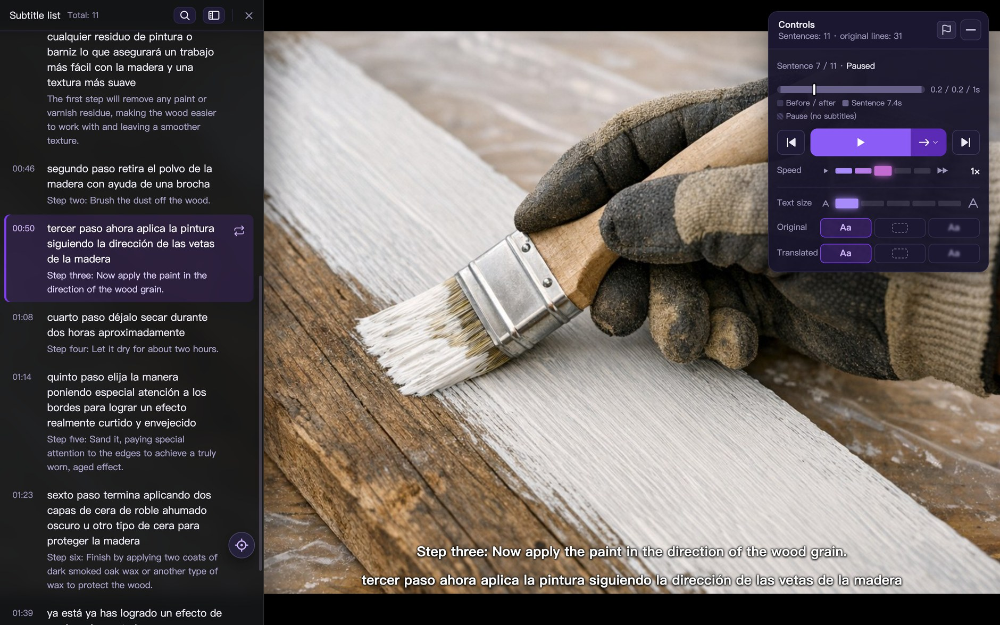
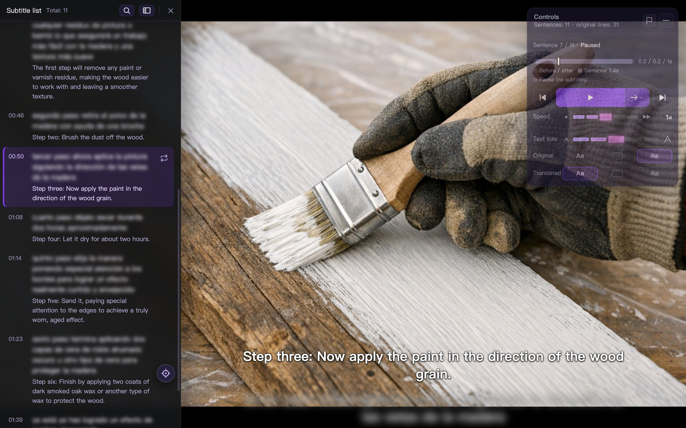

# Earu Language Listening Practice: Learn a Language with Real Videos (2026 Guide)

**English** | [简体中文](README.zh-CN.md)

> Written by the makers of [Earu](https://earu.ai/en/?utm_source=github). We build one of the tools described below, so read this as a **maker's guide**: which kind of tool suits whom, how to choose, and where each one falls short, ours included.
>
> Updated November 2026

## Contents

- [What "learning a language with real videos" means](#what-learning-a-language-with-real-videos-means)
- [Four kinds of language-learning tools, and who each one suits](#four-kinds-of-language-learning-tools-and-who-each-one-suits)
- [Does shadowing and dictation practice actually work?](#does-shadowing-and-dictation-practice-actually-work)
- [How to choose: a six-point check](#how-to-choose-a-six-point-check)
- [Should you practice on a computer or a phone?](#should-you-practice-on-a-computer-or-a-phone)
- [About Earu, the app we make](#about-earu-the-app-we-make)
- [FAQ](#faq)
- [More](#more)
- [Disclaimer](#disclaimer)

## What "learning a language with real videos" means

The idea is simple: skip the fixed curriculum and use what native speakers actually watch (TV shows, movies, cartoons, interviews, anything on a video site) as your material. Understand it by ear, then say it yourself.

It goes by many names, and you may have searched for any of them:

- **Listen and repeat** (Earu calls this Read-aloud): hear a line, pause, say it back.
- **Shadowing**: no pause; you speak along with the audio, a beat behind it.
- **Dictation**: write down exactly what you hear.
- **Intensive listening**: replay a short clip until you catch every word.
- **Extensive listening**: listen a lot, get the gist, keep moving.
- **Comprehensible input**, **immersion**: large amounts of real content you can mostly follow.
- **Learning with TV shows**, **learning English with YouTube**: the everyday way of saying all of the above.

Many learners who practice this way run into the same two problems:

1. **With subtitles on, you read them.** Reading is faster than listening, so listening quietly turns into reading.
2. **With subtitles off, the line you missed just gets rewound again and again.** After a few tries you still can't make it out, and there is nothing to check against.

Most of the differences between tools come down to how they deal with these two problems.

## Four kinds of language-learning tools, and who each one suits

This compares categories, not named products. Tools within a category differ, so take the table as the typical case.

| | Course apps | Dual-subtitle browser extensions | Plain player + dictionary + flashcard app | Practice-oriented video players |
|---|---|---|---|---|
| Where the material comes from | Built into the course | Videos on streaming sites | Anything you can find; plays most video files | A built-in library plus your own videos |
| What you can do with a line | The exercises the course provides | Read two subtitle tracks, click a word for its meaning; some can loop a line | Pause, rewind, replay by hand; some have A-B repeat | Turn the line into an exercise: sort, dictation, read-aloud |
| Speaking practice | Depends on the course | Usually none | You say it yourself, with no feedback | Read-aloud with a word-by-word comparison and a score |
| Hiding subtitles until you need them | Depends on the course | Usually can be hidden | Can be turned off | Covered; uncover only when you can't make it out |
| How much work it takes from you | Least | Low | Most | Medium: you pick the videos |
| Main limit | Someone else decides the pace and the material | Few exercises | Everything is up to you | Your own videos need usable subtitles; exercises interrupt the viewing |
| Best for | People who want their progress planned for them | People who mainly watch and look words up along the way | People who enjoy assembling their own workflow | People who want to turn what they watch into practice material |

No category suits everyone. If you want a complete course, the last three will feel like nobody is guiding you. If you only want to relax and watch, exercises will feel like interruptions.

## Does shadowing and dictation practice actually work?

We won't promise results. A few honest points instead:

- **Struggling to follow speech is often not a vocabulary problem.** You may know every word on the page and still not pick them out in speech, because of linking, reduced sounds, and speed. Reading can't fully stand in for listening to real audio.
- **The three common exercises put your attention on different things.** Sorting has you listen for the order of the words. Dictation makes you account for every word, and shows you exactly where you didn't. Reading aloud has you produce the sounds you just heard.
- **It takes volume.** A handful of lines changes nothing; this needs a lot of input and repeated output over a long stretch of time. A tool can make that time more focused and your mistakes easier to see. It cannot replace the time.
- **The material has to be something you want to watch.** It is hard to keep going long enough to see a difference with content you don't care about.

## How to choose: a six-point check

Whichever tool you end up with, run through these before you install it:

1. **Can you use videos you actually want to watch?** Only the material it provides, or also video sites, files on your computer, and videos in your cloud drive?
2. **Can subtitles be hidden until you need them?** Listen first and look only when you're stuck, rather than all on or all off.
3. **When you get it wrong, does it tell you where?** A plain right/wrong, or the exact word you misspelled or didn't say?
4. **Is there a speaking step?** If you only train listening, speaking will still stall.
5. **What happens to a new word after you save it?** Can you save words while watching, and are they scheduled for review?
6. **Read the limits first.** Does it support the language you're learning? What subtitle formats does it need? Does it need an internet connection or an account? Are your video files and voice recordings sent anywhere?

Point 6 is the one people skip, and the one that most often turns out to matter after installing.

## Should you practice on a computer or a phone?

We don't have a phone app, so we're biased here. With that said:

- **Dictation means typing**, and a keyboard is more comfortable than a phone screen.
- **Reading aloud needs a place where you can speak out loud**, whichever device you use.
- **A phone** suits spare minutes and tap-to-answer exercises such as sorting.
- If you want to use your own video files, a computer is usually easier.

If you have both, we suggest making the computer your main device.

## About Earu, the app we make

Earu belongs to the last column of the table: a video player for listening practice. There are no courses; you choose what to watch. Our view is that listening and speaking are the fastest way into a second language.

### Three exercises

- **Sort**: the line loops while you put the scrambled words back in the order you hear.
- **Dictation**: write the whole line, one word per slot. When you submit, the wrong words are marked and you can fix them.
- **Read-aloud**: listen once, then say it into your microphone. What you said is compared with the original word by word and scored.

### Covered subtitles

Subtitles in the language you're learning are covered by default: listen first, and move the mouse over them to uncover them only when you can't make it out. Subtitles in your native language are not covered by default. The rule is stricter during exercises: subtitles in the language you're learning stay covered, and the original line is shown once you get it right.

### Where the videos come from

- **Earu library**: videos with subtitles in the original language, from Bilibili and YouTube, marked Beginner, Intermediate, or Advanced.
- **Videos on your own computer**: MKV and MP4 open right away. They play only on your own computer and are never uploaded.
- **Cloud drives**: videos stored in a cloud drive, such as Google Drive or Baidu Netdisk, played directly.
- **Your home network storage** (NAS).

Wherever the video comes from, subtitles and practice work the same way. Subtitles in your native language are generated by AI translation, so the video doesn't need to include them.

### Looking up and reviewing words

Rest the mouse on a word to see its card: meaning, pronunciation, and a button to save it to your Word notebook. The Word notebook schedules reviews at growing intervals, and the Daily Quiz tests you on words from lines you've practiced. After you get a line right, you can open its Sentence breakdown.

### Languages

You can learn 12 languages: English, German, French, Japanese, Korean, Turkish, Russian, Spanish, Chinese, Portuguese, Arabic, and Hindi. The app itself comes in 14 display languages.

### Getting started

1. Install Earu on your computer and sign in.
2. Choose the language you're learning and your native language.
3. Pick a video from the library, or open a video file on your computer.
4. Practice as you watch: use Sort, Dictation, and Read-aloud on lines from the video, and save new words to your Word notebook as you go.

### Limits, up front

- **There is no phone app yet.** There is a Lite web version that also works in a phone browser, but it has only Sort and Dictation and fewer video sources than the desktop app. If you can, use the desktop app.
- **The library is uneven across languages.** English has the most videos. For other languages there is less ready-made content, and you may need to bring your own.
- **Videos on your computer have a subtitle requirement**: the video file must contain text subtitles in the language you're learning. Separate subtitle files (such as .srt), image-based subtitles, and subtitles burned into the picture can't be read.
- **AI translation makes mistakes**, and the meaning or pronunciation on a word card is occasionally off.
- **Earu has no shadowing mode.** Read-aloud is listen first, then speak.
- **Subtitle timing is not always right.** Subtitles that drift from the audio are re-aligned, but a few videos are still noticeably off afterwards.
- **Large high-definition videos on Baidu Netdisk load slowly** and can stutter.
- **You need to sign in.** Sign-in, translation, and Read-aloud need an internet connection, and Read-aloud needs a microphone.

### Download

- **Desktop app (Windows)**: [Microsoft Store](https://apps.microsoft.com/detail/9N7CCF3JLGXH)
- **Website**: [earu.ai](https://earu.ai/en/?utm_source=github)
- **Lite web version**: [earu.ai/lite](https://earu.ai/lite/?utm_source=github)

## FAQ

### What is shadowing, and how is it different from listen-and-repeat?

Shadowing means speaking along with the audio without pausing, a beat behind it. Listen-and-repeat means hearing the whole line, stopping, and then saying it. Shadowing is harder and demands more of your speed and rhythm; listen-and-repeat is easier to start with and easier to check word by word. Earu's Read-aloud is the second kind: listen once, read, then compare word by word.

### Is dictation good for listening practice?

Dictation is useful because it doesn't let you gloss over anything: you got the gist, but the word you didn't quite catch shows up the moment you try to write it. It is slow, so it works best on short lines, not on a whole film from start to finish.

### Should I watch with subtitles in my language or in the language I'm learning?

If the goal is listening, both have the same problem: once they're on, you read them. A steadier routine is to listen once with no subtitles, check the parts you missed against the original-language subtitles, and confirm the meaning with subtitles in your native language last. What matters is less which track you turn on than whether you listen before you look.

### Can a complete beginner learn from real videos?

Starting from zero is hard: you can't hear where words begin and end, and you have nothing to check against. Once you have some basic vocabulary and a feel for the sounds, slower videos with short lines are a gentler start. Earu's library is marked Beginner, Intermediate, and Advanced, so you can start from Beginner.

### Can I use my own downloaded videos? What about subtitles?

Yes. MKV and MP4 files open directly. The file needs to contain text subtitles in the language you're learning; separate subtitle files (such as .srt) and image-based subtitles can't be read at the moment. You don't need subtitles in your native language: those are generated by AI translation.

### Are the videos on my computer uploaded?

No. Videos on your computer play only on your own computer and are never uploaded. AI translation and Read-aloud scoring do run online, so subtitle text and what you record for Read-aloud are sent over the internet for processing.

### Do I need an account and an internet connection?

Yes to both. You need to sign in, and sign-in, AI translation, and Read-aloud all need a connection.

### Does it work on a phone?

There is no phone app yet. In a phone browser you can use the Lite web version, which has Sort and Dictation.

### How accurate is the Read-aloud score?

The score comes from comparing what you said with the original line word by word: which words came through and which didn't. It tells you how well this one line matched, not how good your speaking is overall. We have not verified how consistent the score is across accents and microphones.

### Which languages are supported?

You can learn 12: English, German, French, Japanese, Korean, Turkish, Russian, Spanish, Chinese, Portuguese, Arabic, and Hindi. The app comes in 14 display languages.

## More

- [Earu website](https://earu.ai/en/?utm_source=github)
- [User guide](https://earu.ai/en/guide/?utm_source=github)
- [About Earu](https://earu.ai/en/about/?utm_source=github)
- [Lite web version](https://earu.ai/lite/?utm_source=github)

## Disclaimer

This repository contains a guide only: no code, no installer, no scripts.

The descriptions of tool categories are the typical case; an individual product may differ, so check each product's own documentation.

Earu is not affiliated with or endorsed by YouTube, Bilibili, Google, Microsoft, or Baidu. Names and trademarks belong to their respective owners.
