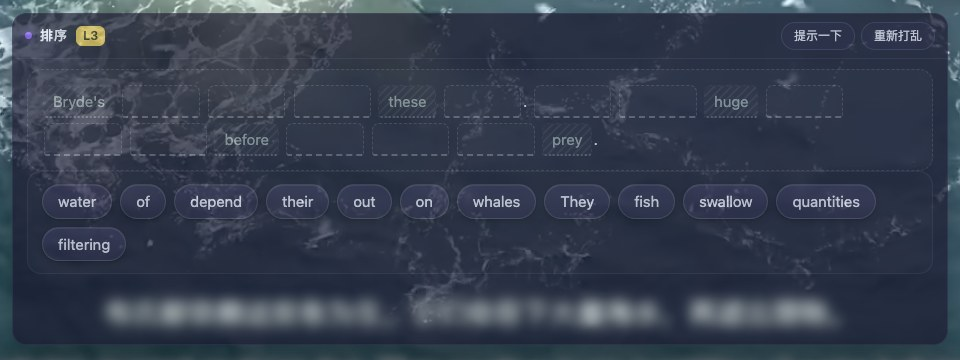

# Earu 语言听力训练：用原声视频练外语听力和口语（2026 指南）

[English](README.md) | **简体中文**

> 本文由「耳如 Earu」的制作方撰写。我们自己做的就是文中的一类工具，所以请把它当成一份**制作方写的指南**来读：哪类工具适合谁、怎么挑、各有什么限制，包括我们自己的。
>
> 更新于 2026 年 11 月

## 目录

- [用原声视频练听力和口语，是怎么回事](#用原声视频练听力和口语是怎么回事)
- [四类工具，各自适合谁](#四类工具各自适合谁)
- [这样练有没有用](#这样练有没有用)
- [怎么挑：六条检查](#怎么挑六条检查)
- [电脑还是手机](#电脑还是手机)
- [耳如 Earu：我们做的这一款](#耳如-earu我们做的这一款)
- [常见问题](#常见问题)
- [更多](#更多)
- [说明](#说明)

## 用原声视频练听力和口语，是怎么回事

意思很简单：不上成套的课，直接拿母语者平时看的视频（电视剧、电影、动画、访谈、各种视频网站上的内容）当材料，听懂它，再照着说出来。

这件事有很多叫法，搜的时候可能用的是其中任何一个：

- **跟读**：听完一句，停下来，照着读出来。
- **影子跟读**（shadowing）：不停顿，紧跟着原声同步说，比原声稍晚一点。
- **听写**：把听到的话完整写下来。
- **精听**：一小段反复听，直到每个词都听清。
- **泛听**：大量地听，听个大意就往下走。
- **可理解输入**、**沉浸式学习**：大量接触自己大致能懂的真实内容。
- **看剧学外语**、**看视频学英语**：以上这些的通俗说法。

这么练的人，不少会碰到同样两个麻烦：

1. **开着字幕，就忍不住去看字幕。** 眼睛比耳朵快，听变成了读。
2. **关掉字幕，听不清的那句只能反复倒回去。** 倒了几次还是听不出来，也没处核对。

各类工具的区别，基本就在怎么处理这两个麻烦。

## 四类工具，各自适合谁

下面按类别比，不点具体产品的名字；每一类里各家的做法也有出入，表里写的是一般情况。

| | 成套课程类应用 | 双语字幕类浏览器扩展 | 普通播放器＋词典＋背词软件 | 带练习的视频播放器 |
|---|---|---|---|---|
| 材料从哪来 | 课程自带 | 视频网站上的视频 | 自己找，大多数视频文件都能放 | 自带片库，加上你自己的视频 |
| 对一句话能做什么 | 做课程配的题 | 看双语字幕、点词查义；有的能单句循环 | 手动暂停、倒回、重听；有的能设一段反复放 | 把这句话做成练习：排序、听写、跟读 |
| 练不练开口 | 看课程设计 | 一般不练 | 自己念，没有反馈 | 跟读后给出逐词对照和评分 |
| 字幕能不能先挡住 | 看课程设计 | 一般可以隐藏 | 可以关掉 | 可以遮盖，听不出来再露出 |
| 要自己花的功夫 | 最少 | 少 | 最多 | 中等，要自己挑视频 |
| 主要限制 | 进度和材料由别人定 | 练习少 | 全靠自己 | 自己的视频要带能用的字幕；练习会打断看视频的节奏 |
| 适合谁 | 想有人把进度安排好的人 | 以看为主、顺手查词的人 | 喜欢自己搭一套流程的人 | 想把看过的视频变成练习材料的人 |

没有哪一类对所有人都合适。想要成套课程的人，用后面三类都会觉得没人带；只想轻松看视频的人，会觉得练习打断了节奏。

## 这样练有没有用

我们不打包票，只说几条实在的：

- **听不懂，常常不是因为不认识那个词。** 单看字幕每个词都认识，放成声音就听不出来，是因为连读、弱读和语速。光看文字，替代不了听真实的声音。
- **三种常见练习，注意力放的地方不一样。** 排序要你听出词和词的顺序；听写要你把每个词都交代清楚，没听清的地方提交后会被标出来；跟读要你把刚听到的声音自己说出来。
- **要量。** 练几句不会有变化，需要相当长时间的大量输入和反复输出。工具能做的，是让同样的时间里听得更专心、错在哪里看得更清楚，它替不了时间。
- **材料要是你自己想看的。** 不想看的东西，很难坚持到见效的那一天。

## 怎么挑：六条检查

不管最后用哪一款，装之前都可以对着这六条过一遍：

1. **能不能用你自己想看的视频。** 只能用它给的材料，还是视频网站、电脑里的文件、网盘里的视频都能用？
2. **字幕能不能先挡住。** 能不能做到先听、听不出来再看，而不是要么全开要么全关？
3. **做错了，它告不告诉你错在哪。** 是只给一个对错，还是标出具体哪个词写错了、哪个词没读出来？
4. **有没有开口这一环。** 只练听不练说，说的时候还是会卡。
5. **生词收下以后有没有下文。** 能不能边看边收，之后会不会安排复习？
6. **先看它的限制。** 支持你要学的语言吗？对字幕格式有什么要求？要不要联网、要不要登录？你电脑里的视频和你的录音会不会被传走？

第 6 条最容易被跳过，也最容易在装完之后才发现不合适。

## 电脑还是手机

我们没有手机版，所以这一节难免带着立场。话说在前头，再说理由：

- **听写要打字**，键盘比手机屏幕顺手。
- **跟读要一个能出声的环境**，用什么设备都一样。
- **手机**适合零碎时间，做排序这类点一点就能完成的练习。
- 想用自己存的视频文件，一般是电脑方便。

所以如果两样都有，建议以电脑为主。

## 耳如 Earu：我们做的这一款

耳如 Earu 属于上面表格里的最后一类：一款用来练听力的视频播放器。它没有课程，看什么由你自己挑。我们的看法是：听和说是学第二语言最快的路。

### 三种练习

- **排序**：句子循环播放，把打乱的词块按听到的顺序排回去。
- **听写**：把听到的句子完整写出来，一个词一格；提交后标出写错的词，可以再改。
- **跟读**：先听一遍，再对着麦克风读；读出的内容和原句逐词对照并打分。

### 字幕遮盖

所学语言的字幕默认遮盖：先听，听不出来再用鼠标划过，让它露出来。母语字幕默认不遮盖。练习的时候规则更严：所学语言的字幕一律遮盖，答对以后原文才显示。

### 视频从哪来

- **片库**：来自哔哩哔哩和 YouTube、带原声字幕的视频，标有初级、中级、高级三档难度。
- **电脑里的视频**：MKV、MP4 直接打开。只在你自己的电脑上播放，不会上传。
- **网盘**：比如 Google Drive、百度网盘里存的视频，直接播放。
- **家里的网络存储设备**（NAS）。

不管视频从哪来，字幕和练习的用法都一样。母语字幕由 AI 翻译生成，不要求视频自带。

### 查词和复习

鼠标停在生词上会弹出词卡，可以看释义、听发音，并收进生词本。生词本按由短到长的间隔安排复习；每日小测从练过的句子里挑词出题。答对一句后，还可以看句子解析。

### 支持的语言

可以学 12 种语言：英语、德语、法语、日语、韩语、土耳其语、俄语、西班牙语、中文、葡萄牙语、阿拉伯语、印地语。界面语言有 14 种。

### 怎么开始

1. 在电脑上安装耳如 Earu，登录。
2. 选好在学的语言和母语。
3. 从片库挑一个想看的视频，或者打开电脑里的视频文件。
4. 边看边练：用排序、听写、跟读练视频里的句子，生词顺手收进生词本。

### 限制，先说在前面

- **暂时没有手机版。** 有一个在线轻量版，手机浏览器里也能用，但只有排序和听写两种练习，视频来源也比电脑版少。有条件的话，建议用电脑版。
- **片库各语言的视频数量不一样**，英语最多。学其他语言，现成的视频少一些，可能要自己找材料。
- **电脑里的视频对字幕有要求**：视频文件里要带有所学语言的文字字幕。和视频分开保存的字幕文件（比如 srt）、做成图片的字幕、印在画面上的字幕，都读不了。
- **AI 翻译会出错**，词卡里个别词的释义和读音也有对不上的时候。
- **没有影子跟读。** 跟读是先听一遍，再读。
- **字幕和声音有时对不齐。** 对不上的字幕会按声音重新对齐，但少数视频校准后仍有明显偏差。
- **百度网盘里体积大的高清视频加载慢**，播放时容易卡顿。
- **要登录**；登录、翻译、跟读都需要联网；跟读需要麦克风。

### 下载

- **电脑版（Windows）**：[微软应用商店](https://apps.microsoft.com/detail/9N7CCF3JLGXH)
- **官网**：[earu.ai](https://earu.ai/zh-hans/?utm_source=github)
- **在线轻量版**：[earu.ai/lite](https://earu.ai/lite/?utm_source=github)

## 常见问题

### 影子跟读（shadowing）是什么？和普通跟读有什么区别？

影子跟读是不停顿、紧跟着原声同步说；普通跟读是听完整句、停下来再读。前者更难，对语速和节奏的要求高；后者更容易上手，也方便逐词核对读得对不对。耳如 Earu 的跟读属于后一种：先听一遍，再读，然后逐词对照。

### 听写对练听力有用吗？

听写的用处在于它不让你含糊过去：大意听懂了，但具体哪个词没听清，一写就露出来了。它比较花时间，适合用在短句子上，不适合整部片子从头写到尾。

### 看视频学外语，该开母语字幕还是外语字幕？

如果目的是练听力，两种字幕都有同一个问题：一开就会去看。比较稳妥的做法是先不看字幕听一遍，听不出来的地方再看外语字幕核对，最后用母语字幕确认意思。所以关键不在开哪一种，而在能不能做到先听后看。

### 没有基础，能直接用原声视频学吗？

完全没有基础会很吃力：听不出词的边界，也没有可以核对的抓手。有了基本的词汇和发音认识之后，从语速慢、句子短的视频开始会顺一些。耳如 Earu 的片库标有初级、中级、高级三档，可以从初级挑起。

### 能用自己下载的视频吗？对字幕有什么要求？

可以，MKV 和 MP4 都能直接打开。要求是视频文件里带有所学语言的文字字幕；单独的字幕文件（比如 srt）和图片字幕目前读不了。母语字幕不需要自带，由 AI 翻译生成。

### 我电脑里的视频会被上传吗？

不会。电脑里的视频只在你自己的电脑上播放，不会上传。不过 AI 翻译和跟读评分是联网完成的，所以字幕文字和跟读时的录音会通过网络发出去处理。

### 要登录吗？要联网吗？

都要。使用前要登录；登录、AI 翻译和跟读都需要联网。

### 手机上能用吗？

暂时没有手机版。手机浏览器里可以用在线轻量版，有排序和听写两种练习。

### 跟读的分数准吗？

分数依据的是读出的内容和原句的逐词对照：哪些词读出来了，哪些没有。它说明的是这一句读得对不对得上，不是对口语水平的评定。在不同口音、不同麦克风下分数准不准，我们没有验证过。

### 支持哪些语言？

可以学的有 12 种：英语、德语、法语、日语、韩语、土耳其语、俄语、西班牙语、中文、葡萄牙语、阿拉伯语、印地语。界面语言 14 种。

## 更多

- [耳如 Earu 官网](https://earu.ai/zh-hans/?utm_source=github)
- [使用指南](https://earu.ai/zh-hans/guide/?utm_source=github)
- [关于耳如](https://earu.ai/zh-hans/about/?utm_source=github)
- [在线轻量版](https://earu.ai/lite/?utm_source=github)

## 说明

本仓库只有这份指南：没有代码，没有安装包，没有脚本。

文中对各类工具的描述是一般情况，具体到某一款产品可能有出入，请以各产品自己的说明为准。

耳如 Earu 与 YouTube、哔哩哔哩、Google、Microsoft、百度没有隶属或合作关系；文中提到的名称和商标归各自所有者所有。
